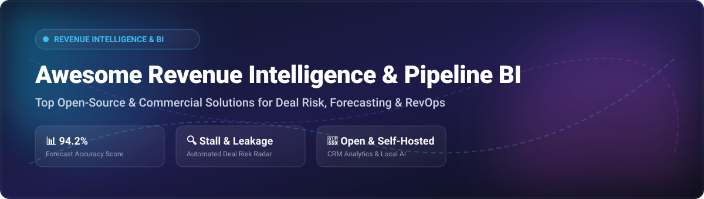

# 🚀 Awesome Revenue Intelligence & Pipeline BI

### 📈 Curated Ecosystem of Commercial SaaS Platforms & Open-Source Projects for Sales Forecasting, Deal Analytics & RevOps

  
  
  
  
  

**Last updated: October 2026**

---

## 🎯 Overview & SEO Keywords

Welcome to the definitive directory for **Revenue Intelligence**, **Sales Pipeline BI**, **AI Revenue Operations (RevOps)**, and **Predictive Sales Forecasting** solutions. This repository tracks both leading **commercial SaaS revenue platforms** (such as Gong, Clari, and Salesforce Revenue Intelligence) and high-impact **open-source GitHub projects** designed for self-hosted pipeline analytics, NRR decomposition, deal stall risk detection, and local AI sales coaching.

*Key Domains Covered:* `Revenue Intelligence` | `Sales Forecasting` | `Pipeline Analytics` | `RevOps` | `Conversation Intelligence` | `Deal Health Scoring` | `B2B Sales AI` | `Self-Hosted BI`

---

## 📑 Table of Contents

- [🏢 SaaS/Hosted Platforms](#saashosted-platforms)
- [⚡ Open-Source GitHub Projects](#open-source-github-projects)
- [🤝 How to Contribute](#how-to-contribute)
- [💖 Support](#support)
- [⭐ Star History](#star-history)
- [⚠️ Disclaimer](#disclaimer)

## SaaS/Hosted Platforms

The global Revenue Intelligence market is estimated at **~$3.8 Billion to $4.5 Billion** (projected to reach **$10.7+ Billion by 2033** at ~12% CAGR). The sector is **moderately fragmented**, featuring a mix of major enterprise suite leaders and specialized point solutions rather than a pure winner-take-all market.

| Platform | Description | Specific Pricing | Free Tier / Trial Limit | Company Size (Valuation / Revenue) |
| :--- | :--- | :--- | :--- | :--- |
| **[Salesforce Revenue Intelligence](https://www.salesforce.com/)** | **Salesforce's native revenue intelligence** — Einstein forecasting, pipeline insights, and conversation intelligence. **Best for Salesforce customers**. | $220 / user / month | 30-day free trial (Sales Cloud trial) | $188B Valuation / $41.5B Revenue |
| **[Clari](https://www.clari.com/)** | **Revenue operations and forecasting platform** — pipeline inspection, forecast accuracy, and deal risk detection with AI. **Best for enterprise revenue operations**. | $100 - $120 / user / month (Base forecasting) | No free plan; custom demo/proof-of-concept trial upon request | $2.6B Valuation / ~$450M Revenue |
| **[Gong](https://www.gong.io/)** | **The revenue intelligence market leader** — conversation intelligence, deal risk detection, forecast accuracy, and AI-powered coaching. **Best for enterprise revenue teams**. | $1,200 - $1,600 / user / year (+$5,000+ base platform fee) | No free trial / No free plan (Guided demo only) | $7.25B Valuation / ~$250M Revenue |
| **[People.ai](https://people.ai/)** | **Revenue intelligence platform** — automatically captures sales activity, identifies deal risks, and provides pipeline analytics. **Best for enterprise sales operations**. | $26 - $50 / user / month (Est. starting tier) | No free plan (Guided enterprise proof-of-concept trial) | $1.1B Valuation / ~$70M Revenue |
| **[Mediafly](https://www.mediafly.com/)** | **Revenue enablement and intelligence** — content, buyer engagement analytics, and revenue intelligence. | $25 / user / month (Est. entry level) | No free plan (Guided demo & trial pilot upon request) | ~$150M Valuation / ~$50M Revenue |
| **[BoostUp.ai](https://www.boostup.ai/)** | **Revenue intelligence and forecasting** — pipeline analytics, deal inspection, and forecast roll-up. **Best for data-driven revenue teams**. | $79 / user / month | 14-day free trial upon request | ~$60M Valuation / ~$10.8M Revenue |
| **[Aviso](https://www.aviso.com/)** | **AI-powered sales forecasting and pipeline management** — deal risk scoring and forecast prediction. **Best for enterprise forecasting**. | $50 - $100 / user / month (Est. enterprise starting tier) | No free plan (Guided sales demo & value estimator tool) | ~$50M Valuation / ~$37M Revenue |
| **[Revenue.io](https://www.revenue.io/)** | **Revenue intelligence and engagement** — real-time guidance, conversation intelligence, and pipeline analytics. **Best for inside sales teams**. | $45 / user / month (Est. starting package) | 14-day free trial on select packages | ~$40M Valuation / ~$25M Revenue |
| **[Troops](https://www.troops.ai/)** | **Revenue operations automation** — Slack-native alerts, deal updates, and pipeline visibility (Acquired by Salesforce/Slack). **Best for Slack-centric revenue teams**. | Included with Salesforce / Slack Enterprise tiers | 14-day free trial (legacy) / Demo via Salesforce | Acquired by Salesforce ($188B Market Cap) |
| **[InsightSquared](https://www.insightsquared.com/)** | **Sales analytics and forecasting** — pipeline analytics, rep performance, and forecast roll-up (Acquired by Mediafly). **Best for mid-market sales teams**. | Integrated into Mediafly platform pricing | No free plan (Legacy 14-day trial) | Acquired by Mediafly (~$150M Valuation) |

## ⚡ Open-Source GitHub Projects

The open-source ecosystem provides robust options for self-hosted CRM data ingestion, pipeline health analysis, RevOps metrics decomposition, and AI-driven conversation intelligence. Below is a curated list sorted by **GitHub Star Count (descending)**.

- **[Apache Superset](https://github.com/apache/superset)** 
  **Leading open-source BI platform**, Apache-2.0 licensed. **Rich visualizations for pipeline dashboards and forecast analytics**. **Best for revenue BI dashboards**.

- **[Twenty](https://github.com/twentyhq/twenty)** 
  **Modern open-source CRM**, AGPL-3.0 licensed. **The open alternative to Salesforce, designed for AI**. **GraphQL API, custom objects, kanban pipelines, email integration, and workflow automation**. **Best for pipeline data foundation**.

- **[Metabase](https://github.com/metabase/metabase)** 
  **Open-source BI and analytics**, AGPL-3.0 licensed. **No-code question builder for sales managers and RevOps teams**. **Best for self-service pipeline analytics**.

- **[Krayin CRM](https://github.com/krayin/laravel-crm)** 
  **Open-source Laravel CRM platform**, MIT licensed. **Leads, contacts, accounts, quotes, and activity pipeline management**. **Best for PHP/Laravel-based pipeline integrations**.

- **[Airbyte](https://github.com/airbytehq/airbyte)** 
  **Leading open-source data integration / ELT platform**, Elv2 / MIT licensed. **Replicate CRM data (Salesforce, HubSpot, Stripe) to warehouses for pipeline BI**. **Best for revenue data pipeline ingestion**.

- **[Cube](https://github.com/cube-js/cube)** 
  **Open-source semantic layer for data applications**, Apache-2.0 licensed. **Headless BI** — define revenue metrics (NRR, ARR, Win Rate) once and expose via GraphQL/REST/SQL APIs. **Best for unified revenue metrics**.

- **[Dagster](https://github.com/dagster-io/dagster)** 
  **Open-source data orchestrator**, Apache-2.0 licensed. **Asset-based orchestration for automated revenue reporting and CRM data pipelines**. **Best for RevOps pipeline data orchestration**.

- **[dbt Core](https://github.com/dbt-labs/dbt-core)** 
  **Open-source analytics engineering framework**, Apache-2.0 licensed. **Transform raw CRM and billing data into structured revenue data models**. **Best for revenue data transformation**.

- **[Great Expectations](https://github.com/great-expectations/great_expectations)** 
  **Shared standard for data quality**, Apache-2.0 licensed. **Validate, document, and audit CRM exports to ensure clean forecasting inputs**. **Best for revenue data quality auditing**.

- **[Lightdash](https://github.com/lightdash/lightdash)** 
  **Open-source Looker alternative for dbt users**, MIT licensed. **Semantic layer built on top of dbt for governed revenue metrics and BI dashboards**. **Best for dbt-centric revenue analytics**.

- **[EspoCRM](https://github.com/espocrm/espocrm)** 
  **Modern, lightweight open-source CRM**, GPL-3.0 licensed. **Contacts, accounts, leads, opportunities, and activities with REST API & webhooks**. **Best for activity capture and lightweight sales tracking**.

- **[HubSpot API Client Python](https://github.com/hubspot/hubspot-api-python)** 
  **Official Python SDK for HubSpot API**, Apache-2.0 licensed. **Programmatic access to deal pipelines, contacts, and engagement analytics**. **Best for custom HubSpot RevOps integrations**.

- **[Signal](https://github.com/jay-sahnan/signal)** 
  **Open-source AI sales intelligence & outreach automation**. **Open alternative to Clay, Apollo, and Outreach**. **Signals engine for buying triggers and lead enrichment**. **Best for AI-powered signal-based outreach**.

- **[GTM Superintelligence](https://github.com/attentiontech/gtm-superintelligence)** 
  **Open-source GTM intelligence for sales calls**. **Three-layer scoring (Call, Deal, Account)** with MEDDPICC grounding and 30 post-call agents. **Best for call coaching and deal slip-risk scoring**.

- **[OpenCloser](https://github.com/issacops/opencloser-v2)** 
  **Open-source local AI SDR & sales team**. **Five specialized agents (Strategist, Researcher, Caller/SDR, Coach, Manager)** running zero-cloud on your local desktop. **Best for privacy-first local AI sales execution**.

- **[DealPulse](https://github.com/Touchpoint-Labs/dealpulse)** 
  **Open-source pipeline health intelligence engine**. **Turns CRM exports into explainable revenue decisions** — surfaces stuck deals, forecast risk, and hygiene gaps. **Best for explainable pipeline health scoring**.

- **[RevOps Intelligence](https://github.com/kubegraf/revops-intelligence)** 
  **Decision-grade revenue analytics for B2B SaaS**. **NRR decomposition, revenue movement bridges, and cohort retention analysis**. **Best for boardroom-ready SaaS revenue analytics**.

- **[Pipeline Integrity Copilot](https://github.com/Pipeline-Integrity/pipeline-integrity-copilot)** 
  **Deterministic hygiene and backfill auditing agent for CRM pipelines**. **Audits stage transitions and field changes against policy rules**. **Best for CRM backfill and hygiene auditing**.

- **[Revenue Leak Radar](https://github.com/RainMaker-Maestro/revenue-leak-radar)** 
  **Silent revenue leakage detection across billing, FX, and churn**. **Identifies lost revenue across Stripe and CRM ledgers**. **Best for revenue recovery**.

- **[Pipeline Pulse](https://github.com/aashu2003/pipeline-pulse)** 
  **Open-source pipeline stall-risk analyzer**. **Simple, explainable heuristics for aging close windows**. **Best for quick dependency-light risk checks**.

- **[CallSense](https://github.com/aaron-seq/ML-voice-lead-analysis)** 
  **Self-hosted voice lead analysis & coaching**. **Explainable lead scoring (0-100), objection detection, and buyer intent mapping**. **Best for lead scoring & call coaching**.

---

**Frameworks for building custom revenue intelligence solutions**: Combine **DealPulse** for explainable pipeline health scoring on CRM exports. Use **RevOps Intelligence** for board-level NRR decomposition and rolling forecasts. Deploy **Pipeline Integrity Copilot** for deterministic CRM hygiene auditing. Integrate **Revenue Leak Radar** for silent revenue leakage detection. Use **CallSense** or **GTM Superintelligence** for conversation intelligence and coaching. Build on **Apache Superset** or **Metabase** for self-service revenue dashboards. Note that true enterprise revenue intelligence with real-time conversation analysis, automated CRM sync at scale, and vendor-supported SLAs (Gong, Clari, Aviso) remains primarily commercial territory; open-source stacks provide strong pipeline analytics, explainable scoring, and revenue leak detection foundations that require integration for complete revenue intelligence operations.

## 🤝 How to Contribute

1. Fork the repository.
2. Add/edit entries in `README.md` following the established format.
3. Include: name, link, 1–2 sentence description, and relevant tags/pricing details.
4. Submit a Pull Request with a clear summary of changes.

---

## 💖 Support

If you find this curated list helpful for your RevOps strategy, sales engineering, or pipeline analytics research:

- ⭐ **Star** this repository on GitHub to help others discover it!
- 🔀 **Fork** and share it with your team and RevOps community.
- ☕ **Sponsor / Buy a Coffee**: Support ongoing open-source maintenance and curation via [GitHub Sponsors](https://github.com/sponsors/ishandutta2007).

---

## ⭐ Star History

---

## ⚠️ Disclaimer

- This repository is a **community-curated** resource list for educational and research purposes — it does not constitute financial or commercial endorsement.
- Revenue intelligence and CRM platforms process sensitive enterprise data and PII. Self-hosted deployments require strict security hardening, role-based access control, and GDPR/CCPA compliance.
- Data quality directly governs forecast accuracy: hygiene tools should be integrated to clean CRM inputs prior to scoring.
